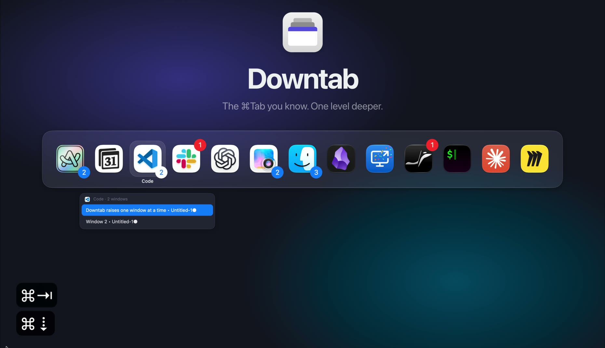

# Downtab

A macOS app switcher that works like ⌘Tab, and lets you drop down to a single window of an app.

Entirely keyboard-driven: `⌥Tab`, `Tab`, `Tab`, `↓`, `↓`, `release`.

- **Feels like ⌘Tab**: hold ⌥ and press Tab to see apps in most-recently-used order.
- **Drop down to a window**: press ↓ on an app with two or more windows to pick just the one you want.
- **Window shortcut**: ⌥` opens the switcher on the current app with its windows already listed.
- **Current Space only**: only windows on the Spaces you're looking at, on every display.
- **Titles, no thumbnails**: no Screen Recording permission, no capture lag.

macOS 15 or later · Apple Silicon only. Download, install steps and troubleshooting: **[downtab.doubleloop.io](https://downtab.doubleloop.io/)**.

## Development

Before changing behavior read `docs/principles.md`. Decisions: `docs/adr/`. Terms: `GLOSSARY.md`.

### Requirements

- macOS with the Command Line Tools (Swift 6.4). Xcode is not needed.

### Commands

All commands go through `make` (run it with no target for the list). Prefer it over bare `swift build` / `swift test`: it works around a Swift 6.4 issue where a `swift build` breaks the next `swift test`.

| Command | What it does |
| --- | --- |
| `make setup-signing` | Once per clone: creates a self-signed certificate in a dedicated keychain under `.signing/` (git-ignored) of the main checkout; git worktrees use that one too. The login keychain is not touched. |
| `make build` | Debug build. |
| `make test` | Runs `make check-core` and `make lint`, then the tests (Swift Testing). |
| `make check-core` | Fails if the Switcher core imports anything but Foundation, or loads private APIs. |
| `make lint` | Format check with swift-format (`.swift-format`), then SwiftLint (pinned in `Package.swift`, rules in `.swiftlint.yml`). Any violation fails. |
| `make format` | Rewrites sources with swift-format. |
| `make icon` | Renders `App/Icon/*.svg` into `App/AppIcon.icns` (needs `rsvg-convert`). The `.icns` is committed; rerun only after editing an SVG. |
| `make bundle` | Release build, assembles `build/Downtab.app`, stamps the version (see Versioning) and signs it and `build/EmergencyRestore` with the hardened runtime: with the Developer ID when the login keychain holds it, otherwise with the local certificate. `SIGN_WITH=developer-id` or `SIGN_WITH=self-signed` forces one. |
| `make notarize-check` | Release Mac only. Checks the release preflight (see Distribution), bundles with the Developer ID, packs `Downtab.app`, `EmergencyRestore`, `LICENSE` and an `/Applications` link into `build/Downtab.dmg`, signs, notarizes and staples it, then verifies it with `stapler validate` and `spctl` (`Notarized Developer ID`). Tags and publishes nothing; `make release` runs the same steps. |
| `make run` | Quits a running instance, bundles, then launches the app. |
| `make stop` | Quits the running app. |
| `make version V=X.Y.Z` | Closes `## [Unreleased]` in `CHANGELOG.md` as `## [X.Y.Z] - <today>` and writes `X.Y.Z` to `VERSION`. Refuses a malformed or non-greater `V`, or an empty `[Unreleased]`. Commits nothing. |
| `make release` | Refuses unless on `main`, clean, not shallow, `VERSION` greater than every `v*` tag, no tag or public release for it yet, a non-empty changelog section for it, and `make test` passing. Then runs `make notarize-check`, tags `vX.Y.Z`, pushes the tag and publishes the release in this repo (see Distribution). |
| `make ship V=X.Y.Z` | Refuses unless `V` is valid and greater than `VERSION` and every `v*` tag, on a clean `main` equal to `origin/main`, the release preflight passes, and `make test`, `make smoke` and `make notarize-check` pass. Then `make version`, commits `VERSION` and `CHANGELOG.md` as `Release vX.Y.Z`, pushes `main` and runs `make release`. |

## Versioning

- `VERSION` holds the version `X.Y.Z` (one line), written into the bundle as `CFBundleShortVersionString`.
- The build number (`CFBundleVersion`) is the commit count of `HEAD`, computed by `make bundle`; it only grows because releases are built from `main`. A shallow clone has no reliable count, so `make bundle` refuses it.
- `CHANGELOG.md` is written for users ([Keep a Changelog](https://keepachangelog.com/en/1.1.0/)): it becomes the public release notes.

Release:

1. Add user-facing entries under `## [Unreleased]` in `CHANGELOG.md` while working.
2. `make version V=X.Y.Z`, commit on `main`.
3. `make smoke` (manual, needs Accessibility).
4. `make release` (from `main`).

Or, after step 1, `make ship V=X.Y.Z` runs steps 2–4, smoke and `make notarize-check` first. If it fails after the push, fix the cause and rerun `make release`: notarization can still fail then, but only on a transient error (notary or timestamp outage, network).

## Distribution

Users download from this repo:

- The download page is its GitHub Pages site, deployed by `.github/workflows/pages.yml` on every push to `main` that touches `website/`: it publishes `website/downtab-landing.html` as `index.html`, next to the demo video `downtab-demo.mp4`, its cover `downtab-demo-cover.jpg` and the social preview `downtab-og.jpg`. URL: `https://downtab.doubleloop.io/`.
- Its releases carry `Downtab.dmg`, published by `make release` with the version's `CHANGELOG.md` section as notes. Stable link: `https://github.com/doubleloop-io/downtab/releases/latest/download/Downtab.dmg`. Releases up to 0.4.2 carry `Downtab.zip` instead.
- Apple Silicon only. Releases are signed with `Developer ID Application: doubleloop srl (49CP6UC6KC)`, notarized and stapled: the DMG, not a zip, because a bare Mach-O like EmergencyRestore cannot be stapled, while the disk image covers it offline. `make run` and `make smoke` sign with the Developer ID too where the login keychain holds it (see Signing and permissions), and with the self-signed certificate elsewhere, so contributors need no Apple account.
- The release Mac holds the identity in the login keychain and the notarytool credentials in the keychain profile `downtab-notary`. The release preflight, run by `make ship` before anything changes and by `make notarize-check`, checks both, and that `gh` is authenticated with push permission on this repo.
- The release Mac also holds the Sparkle EdDSA private key that signs updates, in the login keychain under the account `io.doubleloop.downtab` (`generate_keys -p --account io.doubleloop.downtab` prints its public key, `SUPublicEDKey`). Its backup, the file `downtab-sparkle-key`, lives in the team password manager, never in the repo. Losing the key means installed copies can never update again. To use it on another Mac: `generate_keys -f downtab-sparkle-key --account io.doubleloop.downtab`. The `generate_keys` tool ships in the `bin/` of the Sparkle 2 release tarball.
- If `make release` fails after pushing the tag, it prints the `gh release create` command to finish by hand. Notarization runs before the tag, so it never leaves a tag without a release.

## Layout

- `Sources/SwitcherCore`: pure Switcher logic, no AppKit, AX or private APIs. Tested in `Tests/SwitcherCoreTests`.
- `Sources/Downtab`: the app (menu bar item, AppKit adapters).
- `App/Info.plist`: bundle metadata (`LSUIElement`, no Dock icon); no version keys, `make bundle` stamps them.
- `Makefile`, `scripts/`: developer commands; `scripts/` holds the steps too long for a Makefile recipe.
- `docs/principles.md`: the intent later changes must not betray.
- `docs/adr/`: decisions and their trade-offs; `docs/adr/assets/` holds the UI prototypes.
- `docs/manual-checklist.md`: checks to run by hand on the real app.
- `website/`: the download page, its demo video and cover, deployed by the Pages workflow; `website/recording/` holds the unpublished sources: the recording prop `backdrop.html` and `og-image.html`, which renders `downtab-og.jpg` at 1200×630 (headless Chrome `--window-size=1200,630 --screenshot`).

## Signing and permissions

The bundle is signed with the same identity on every build, so the Accessibility permission survives rebuilds. macOS keeps one Accessibility grant per bundle id, tied to the signature's designated requirement: a build signed differently from the granted one does nothing until granted again, and that grant drops the other's.

- Where the login keychain holds the Developer ID (the release Mac), every build signs with it: `make run` and the installed release share one grant (requirement on the Team ID).
- Elsewhere, builds sign with the self-signed certificate of `make setup-signing`. Deleting `.signing/` (or a fresh clone) creates a new certificate: run `setup-signing` again and re-grant Accessibility. Running a release there too means re-granting at each switch.

CI (`.github/workflows/ci.yml`) only builds and tests; it never signs or bundles. It uses the runner's default Xcode, which can be older than the local toolchain (no hosted runner ships Swift 6.4 / the macOS 27 SDK yet); the `Versions` step logs what it ran with. Code must therefore also build with that older toolchain.

## License

Copyright © 2026 doubleloop.

Downtab is free software: you can redistribute it and/or modify it under the terms of the GNU General Public License as published by the Free Software Foundation, either version 3 of the License, or (at your option) any later version (`GPL-3.0-or-later`). See [`LICENSE`](LICENSE).

- **Name and icon**: the license covers the code, not the Downtab name or icon. Forks that distribute builds must use a different name and icon.
- **Contributions**: external contributions will require signing a Contributor License Agreement (CLA) before they can be merged.
- **Acknowledgments**: some interoperability facts about private macOS APIs (function signatures, record offsets, symbolic hotkey ids, the remote-token window lookup) were learned by reading [AltTab](https://github.com/lwouis/alt-tab-macos) (GPL-3.0). No AltTab code is copied.
